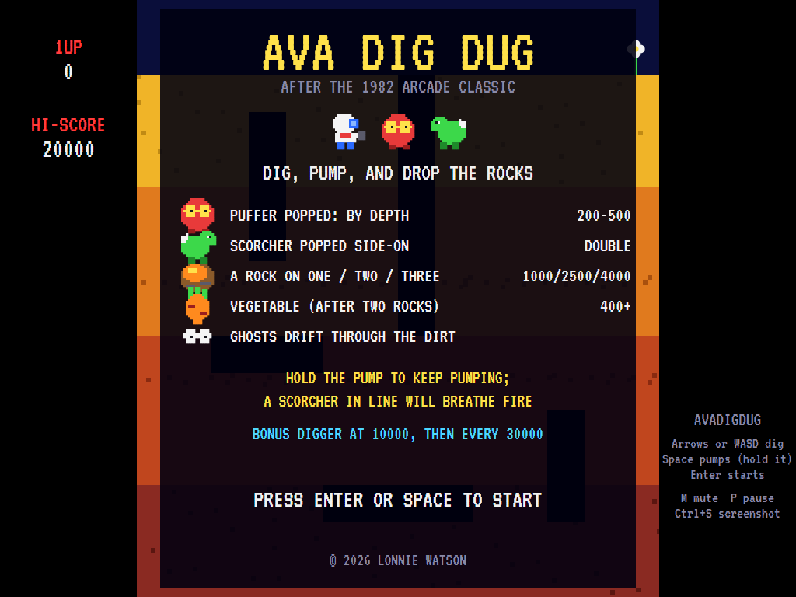
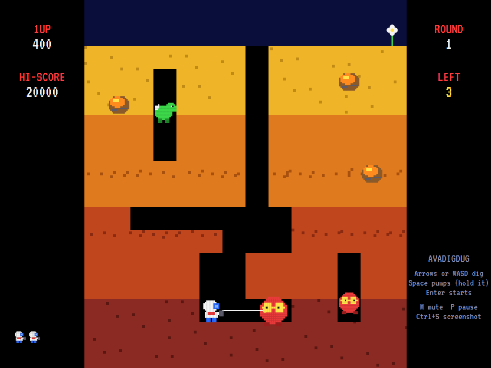
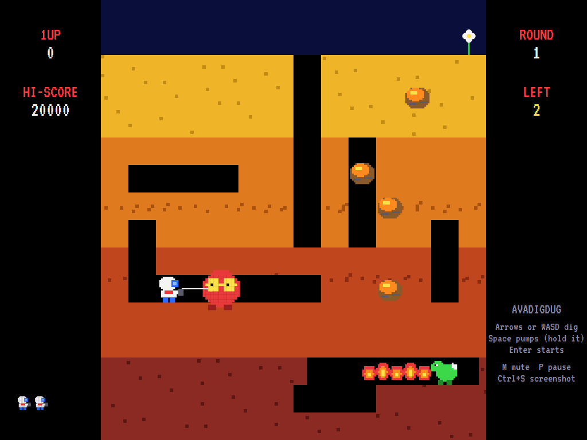
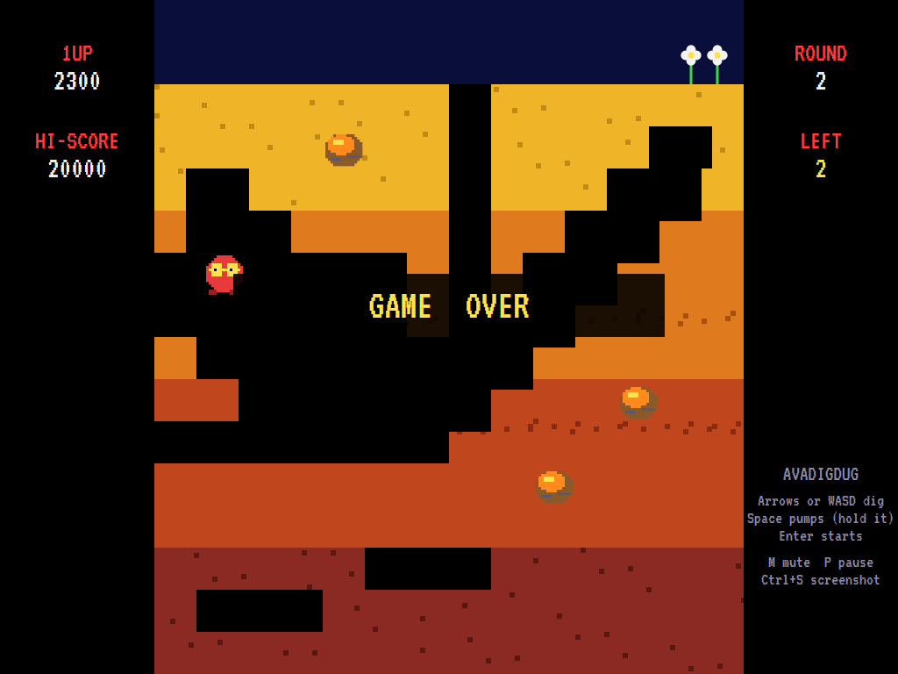
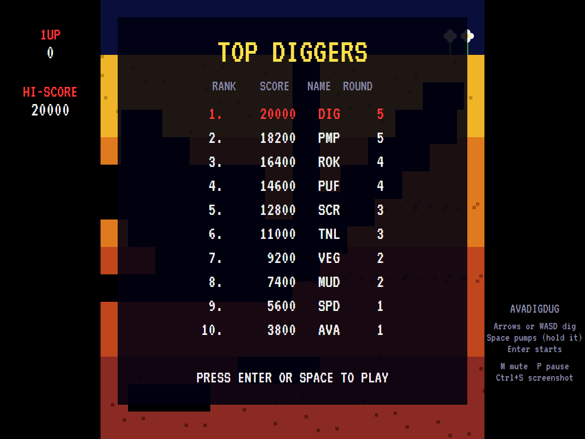

# AVADigDug

[](https://github.com/Harlock123/AVADigDug/actions/workflows/build.yml)

A digging game in the style of Namco's 1982 arcade game **Dig Dug**, built with .NET 10 and Avalonia
UI. Tunnel through four layers of earth, pump the monsters up until they pop, and drop rocks on them.
The digger and the monsters (the round, goggled **puffers** and the fire-breathing **scorchers**) are
this game's own.

## Features

- **Digging**: the digger cuts a tunnel wherever it goes, on a 16-pixel grid. Ask it to turn between
  grid lines and it carries on to the next line first, as on the arcade. It can walk along the surface
  too.
- **The pump**: the harpoon flies along the tunnel (not through dirt) and hooks the first monster it
  meets. Each pump blows it up a size; four pumps and it **pops**. Hold the button to keep pumping. Let
  go and it shrinks back and comes after you again. Monsters are worth more the deeper they were, and a
  scorcher popped side-on is worth double.
- **The monsters** wander the tunnels towards you. Now and then they turn into **ghosts**, a pair of
  eyes drifting straight through the dirt, and become solid again when they reach a tunnel. A
  **scorcher** in line with you stops, glows, and **breathes fire** along the row. The **last monster**
  makes a run for it to the surface and away.
- **Rocks**: dig out the dirt under one and it wobbles and falls, flattening whatever is below: 1000
  for one monster, 2500 for two, 4000 for three, and on up. If you're right underneath it waits for you
  to move, so mind you don't move down. Drop two rocks and a **vegetable** appears in the middle: a
  carrot worth 400 on round 1, up to a pineapple worth 8000.
- **Rounds**: each has a new layout, with more monsters (up to eight) and more rocks, and the monsters
  get quicker and turn ghost sooner. A flower on the surface counts each round.
- **Music** that plays only while you're moving, as on the arcade, plus original tunes and effects,
  all mixed by OpenAL.
- **Attract mode**: leave the title alone for 15 seconds and a computer player plays a demonstration,
  with all its sounds. It digs into line with a monster, pumps it, and keeps out of the way of fire and
  loose rocks; it regularly clears several rounds.
- **Three diggers**, a bonus digger at 10,000 and every 30,000 after, and a **top-ten high-score
  table** with arcade-style initials entry.
- **Any window size**: the screen scales to fit, letterboxed. **Ctrl+S** saves a screenshot.
- **One self-contained executable** per platform: Windows, macOS and Linux on Intel/AMD and ARM.

The layouts, sprites, sounds and tunes are all this game's own.

## Screenshots

| Title screen | Digging and pumping | Fire and a falling rock |
|:------------:|:-------------------:|:-----------------------:|
|  |  |  |
| The monsters and what they're worth. | A puffer pumped up at the end of the harpoon. | A scorcher breathing fire, and a rock on its way down. |

| Game over | The high-score table |
|:---------:|:--------------------:|
|  |  |
| Out of diggers. | The best diggers. |

The screenshots are made by the tests, which play the game in a real (headless) window; see
[Tests](#tests).

## Download and run

Ready-to-run builds for Windows, macOS and Linux, on both Intel/AMD and ARM, are on the
[Releases page](https://github.com/Harlock123/AVADigDug/releases/tag/latest). **Latest build** is
rebuilt on every push to `main`. Each download is one self-contained executable: no .NET install is
needed.

| Platform | Archive |
|---|---|
| Windows | `AVADigDug-win-x64.zip`, `AVADigDug-win-x86.zip`, `AVADigDug-win-arm64.zip` |
| macOS | `AVADigDug-osx-arm64.tar.gz` (Apple silicon), `AVADigDug-osx-x64.tar.gz` (Intel) |
| Linux | `AVADigDug-linux-x64.tar.gz`, `AVADigDug-linux-arm64.tar.gz`, `AVADigDug-linux-arm.tar.gz` |

```bash
tar -xzf AVADigDug-linux-x64.tar.gz     # or linux-arm64, linux-arm, osx-arm64, osx-x64
./AVADigDug
```

On Windows, unzip and run `AVADigDug.exe`. On macOS, if Gatekeeper refuses to open it, run
`xattr -d com.apple.quarantine AVADigDug` once. Run with `--no-audio` for silence.

**Sound** comes through OpenAL Soft, built in for every platform. In a virtual machine the game
detects it and uses a larger audio buffer, so the sound doesn't break up.

**Gamepads** use SDL2, which is bundled for Windows, macOS and Intel/AMD Linux. ARM Linux builds need it
installed; without it the keyboard still works:

```bash
sudo apt install libsdl2-dev            # Debian / Ubuntu / Raspberry Pi OS
sudo pacman -S --needed sdl2-compat     # Arch / Omarchy
```

## Controls

| Input | Action |
|-------|--------|
| **Arrow keys** / **WASD** | Dig and walk |
| **Space**, **Ctrl**, **Z** or **X** | Shoot the harpoon; pump (hold to keep pumping) |
| **Enter** / **Space** | Start a game |
| **P** / **Esc** | Pause (Esc again to quit) |
| **M** | Mute |
| **Ctrl+S** / **Cmd+S** | Save a screenshot to the Pictures folder |

**Gamepad**: the left stick or D-pad digs, **A**, **B** or **X** pumps, **Start** starts and pauses,
**Back** (while paused) quits.

**Entering initials**: type letters, or dial with **Up**/**Down** and accept with **Space**; **Left** /
**Backspace** go back; **Enter** finishes.

## Scoring

| What | Points |
|---|---:|
| Popping a monster, by the layer it was in (top to bottom) | 200, 300, 400, 500 |
| A scorcher popped side-on | Double |
| One rock on one / two / three / four monsters | 1000 / 2500 / 4000 / 6000, and on up to 15000 |
| The vegetable (after two rocks) | 400 (carrot) to 8000 (pineapple) |

## Tests

```bash
dotnet test AVADigDug.slnx
```

The engine has no UI and runs in fixed 60 Hz steps, so it plays the same at any frame rate, and a seed
always plays the same game. The tests check:

- the round layouts, digging, and turning only on the grid lines;
- the harpoon and the pump: hooking, popping, points by depth, double for scorchers, holding to pump,
  shrinking back, dirt and ghosts;
- being caught or burned, rocks falling on monsters, a rock waiting for the digger and then falling on
  them, and the vegetable;
- ghosts crossing the dirt, the last monster's escape and the next round, and bonus diggers;
- the music heard only on the move, the title tune and the demonstration's sound, and every sound and
  sprite.

A computer player (the attract-mode one) plays whole games in them and must reach round 3.

The screenshot tests draw the real screen in a headless window. To refresh the README's pictures:

```bash
DIGDUG_SHOTS=$PWD/Images dotnet test tests/AVADigDug.Tests --filter ScreenshotTests
```

## Building

```bash
dotnet build AVADigDug.slnx
dotnet run --project src/AVADigDug
```

Needs the .NET 10 SDK. The sounds are made by `tools/make_sounds.py` (standard-library Python):
`python3 tools/make_sounds.py` rewrites `src/AVADigDug/Sounds`.

## Project structure

```
AVADigDug/
├── AVADigDug.slnx
├── src/AVADigDug/
│   ├── Engine/
│   │   ├── GameEngine.cs        # States, scoring, bonus diggers and the music
│   │   ├── GameEngine.Play.cs   # Digging, the pump, the monsters and their ghosts and fire, rocks,
│   │   │                        # the vegetable, the last monster's escape, and the rounds
│   │   ├── Entities.cs          # The digger, the harpoon, monsters and rocks
│   │   ├── AttractPilot.cs      # The computer player for the demonstration (and the tests)
│   │   ├── HighScoreTable.cs, InitialsEntry.cs
│   │   ├── InputHandler.cs, ControllerManager.cs  # Keys and an SDL2 gamepad
│   │   └── SoundManager.cs      # Effects, tunes and the digging music through OpenAL
│   ├── Audio/                   # The OpenAL engine (from the author's AVABand)
│   ├── Models/                  # The playfield, the earth and each round's layout, and the pixel art
│   ├── Views/                   # The screen: the earth and tunnels, the diggers and monsters, panels
│   └── Sounds/                  # The synthesised effects and tunes
├── tests/AVADigDug.Tests/       # Gameplay and screenshot tests
├── tools/make_sounds.py
└── Images/                      # Screenshots
```

## About and licence

AVADigDug © 2026 Lonnie Watson, under the [MIT License](LICENSE).

*Dig Dug* © 1982 Namco (Bandai Namco Entertainment); the name belongs to its owner. AVADigDug is an
independent, unofficial game in its style. Its characters, layouts, sprites, sounds, tunes and code are
its own; nothing is taken from the arcade machine's program, graphics or sound. It is not affiliated
with or endorsed by any rights holder.

Bundled components keep their own licences: the VT323 font (SIL Open Font License 1.1, by Peter Hull;
`src/AVADigDug/Assets/Fonts/VT323-OFL.txt`), OpenAL Soft (LGPL-2.0-or-later; loaded as a separate
library; `src/AVADigDug/Audio/native/COPYING-openal-soft.txt`), and the MIT-licensed Avalonia,
Silk.NET, NVorbis, NLayer and SDL2-CS (with SDL2 under the zlib licence).
